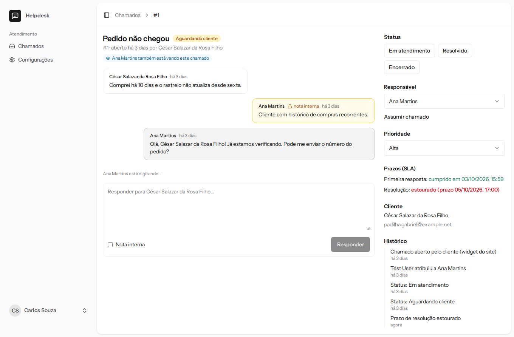
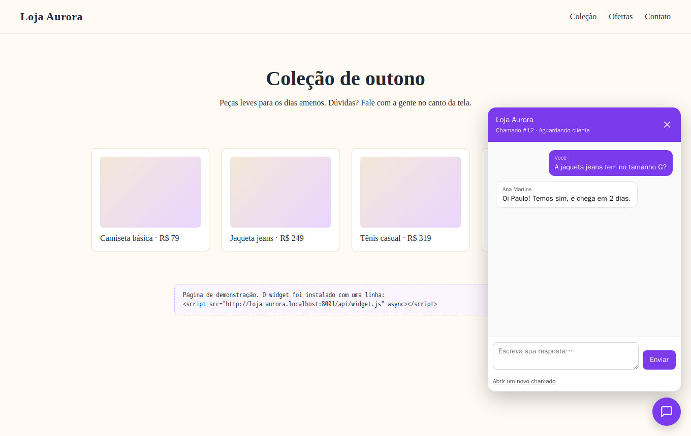
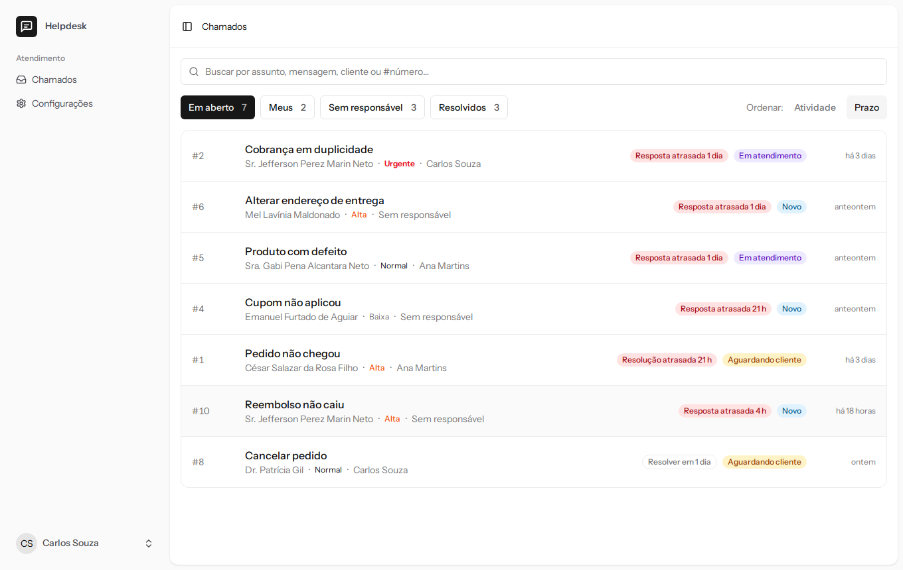
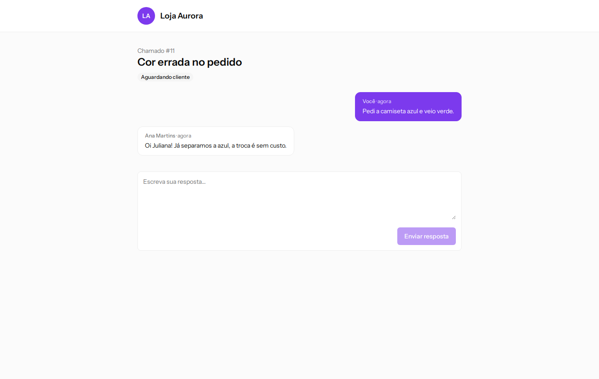
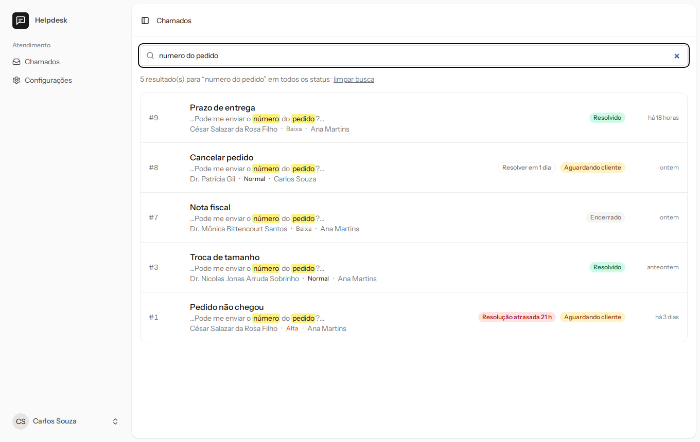
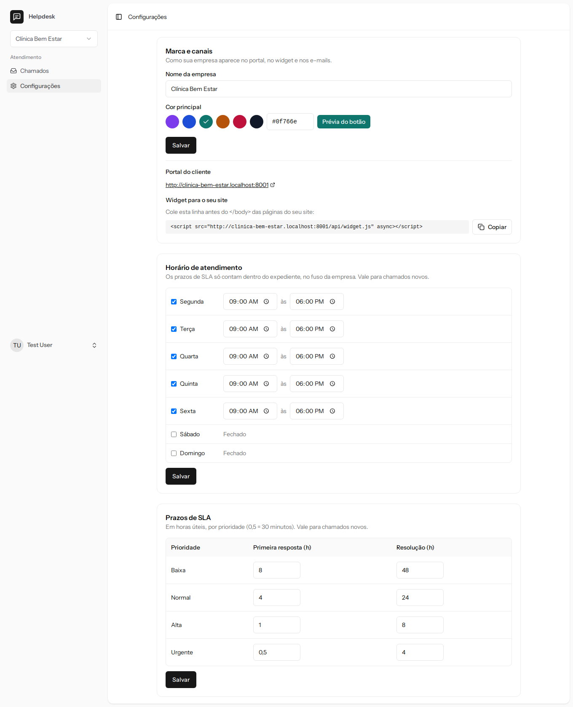

# Helpdesk — central de atendimento whitelabel em tempo real

[](https://github.com/Vitor-assis20/helpdesk-whitelabel/actions/workflows/tests.yml)
[](https://github.com/Vitor-assis20/helpdesk-whitelabel/actions/workflows/lint.yml)

SaaS multi-tenant de atendimento ao cliente. Cada empresa recebe chamados pelo **widget no próprio site** ou por um **portal com a sua marca**, e a equipe responde num painel que se atualiza **em tempo real** — com notas internas, responsáveis, prazos de SLA em horário comercial e busca full-text.

**Stack:** Laravel 12 · PHP 8.4 · Laravel Reverb (WebSocket) · React 19 · TypeScript · Inertia.js · Tailwind CSS 4 · PostgreSQL 17 · Redis · Docker

| Dois atendentes no mesmo chamado: presença e "digitando…" | Widget no site da empresa, conversando com o painel |
| --- | --- |
|  |  |

| Caixa de entrada ordenada por prazo de SLA | Portal do cliente, com a marca da empresa |
| --- | --- |
|  |  |

<details>
<summary>Mais telas</summary>

| Busca sem acento, com trecho destacado | Configuração da empresa |
| --- | --- |
|  |  |

</details>

## Funcionalidades

**Painel da equipe**
- Caixa de entrada com abas (em aberto, meus, sem responsável, resolvidos) e ordenação por atividade ou por prazo
- Conversa com respostas públicas e **notas internas**; status, responsável, prioridade e histórico auditável
- **Tempo real:** novos chamados e mensagens aparecem sem recarregar; quem mais está vendo o chamado e quem está digitando
- **SLA:** prazos de primeira resposta e resolução por prioridade, contados só em horário comercial, com alerta por e-mail quando estouram; o prazo de resolução pausa enquanto o chamado aguarda o cliente
- **Busca full-text** em assunto, mensagens, cliente e número — sem acento e enquanto digita
- Configuração da marca, do expediente e dos prazos; papéis de dono, administrador e atendente

**Para o cliente** (sem criar conta)
- **Widget** instalado com uma linha no site da empresa
- **Portal** no subdomínio da empresa (`loja-aurora.seudominio.com`)
- Conversa em tempo real e e-mails com a marca da empresa (recebido, nova resposta, resolvido)

## Decisões técnicas

### Tempo real sem vazar conteúdo
Toda mudança num chamado dispara um único evento ([`TicketChanged`](app/Events/TicketChanged.php)) que **não carrega conteúdo** — só o id, o número e o tipo da mudança. Quem recebe recarrega os dados pelo servidor, que aplica permissões e filtros. Assim:
- **Nota interna nunca passa pelo WebSocket**, e o evento de uma nota nem é publicado no canal do cliente;
- o evento é publicado **depois do commit** e leva só escalares: ele passa pela fila, e o worker não tem empresa no contexto para recarregar models com escopo.

Canais privados por empresa e por chamado são autorizados só para a equipe daquela empresa. Um canal de **presença** mostra quem está no chamado, e o "digitando…" vai por *whisper*, direto pelo Reverb, sem passar pelo servidor.

### Cliente sem login, widget sem cookies
O cliente acessa o chamado por um **link secreto** (token aleatório de 40 caracteres). O canal em tempo real dele é autorizado por esse token num endpoint próprio, que assina a resposta no protocolo do Pusher/Reverb ([`BroadcastAuthController`](app/Http/Controllers/Portal/BroadcastAuthController.php)) — o fluxo padrão do Laravel exige usuário logado.

O widget roda no site da empresa, em **outra origem**. A primeira ideia era abrir o portal num iframe, mas navegadores bloqueiam cookies de terceiros: sem sessão, o CSRF do Laravel falharia. Por isso o widget é um app TypeScript que fala com uma **API JSON sem sessão nem cookies** (CORS sem credenciais), autenticada pelo token, e guarda o token no `localStorage` do site para retomar a conversa.

### Widget embutível
- TypeScript puro (sem React), compilado pelo Vite num único arquivo: **~22 KB com gzip**
- **Shadow DOM**: o CSS do site não afeta o widget, e o do widget não vaza para o site
- Texto de usuário entra sempre por `textContent`, nunca `innerHTML`
- O servidor entrega o script já com a configuração da empresa (nome, cor, endereços)

### SLA em horário comercial
[`BusinessCalendar`](app/Helpdesk/Sla/BusinessCalendar.php) soma e conta minutos úteis no fuso da empresa — noites, fins de semana e pausas não contam: um chamado normal (4 h úteis) aberto sexta às 17h30 vence segunda às 12h30.

Enquanto o chamado aguarda o cliente, o prazo de resolução **pausa**: quando o cliente responde, volta o tempo útil que faltava. As pausas ficam somadas num contador, então recalcular o prazo (ao mudar a prioridade) não as perde, e pausar depois do estouro não o apaga.

Um job a cada minuto marca os estouros com `UPDATE ... RETURNING`: marcar e devolver numa operação atômica faz com que duas execuções simultâneas **nunca avisem o mesmo estouro duas vezes** ([`CheckSlaBreaches`](app/Console/Commands/CheckSlaBreaches.php)).

### Multi-tenancy com garantias no banco
Banco único com `tenant_id` em todas as tabelas, um *global scope* que **falha fechado** (sem empresa no contexto, nada é visível) e chaves estrangeiras compostas `(tenant_id, id)` entre as tabelas. Além disso:
- **Número do chamado por empresa** (#1, #2…) com um contador atômico (`UPDATE ... RETURNING`), sem colisão entre aberturas simultâneas;
- **responsável sempre da equipe**: FK composta para a tabela de membros, com `ON DELETE SET NULL (assignee_id)` (Postgres 15+) — se o atendente sai da equipe, só o responsável é removido;
- **cliente nunca escreve nota interna**: `CHECK` no banco.

### Busca full-text no Postgres
Configuração própria `pt_unaccent` (unaccent + radicais em português), vetores em **colunas geradas** com índices GIN e prefixo enquanto digita ("reemb" encontra "Reembolso"). Só letras e dígitos chegam ao `tsquery`, e o trecho destacado volta como segmentos de texto — nada de HTML vindo do cliente ([`TicketSearch`](app/Helpdesk/TicketSearch.php)).

## Qualidade

- **117 testes** (unitários, feature e integração) rodando em **PostgreSQL real**, incluindo regras do banco, isolamento entre empresas, autorização de canais, serialização para a fila e entradas hostis na busca
- Fluxos validados ponta a ponta em navegador (Playwright): dois atendentes ao vivo, cliente no portal, widget em outra origem
- CI no GitHub Actions: testes com Postgres, Pint, Prettier, ESLint e `tsc`

```
app/
├── Helpdesk/            Ações de domínio (abrir, responder, status, responsável, prioridade),
│   └── Sla/             busca, e-mails ao cliente; calendário e relógio de SLA
├── Events/              TicketChanged (tempo real)
├── Http/Controllers/    Panel/ (equipe), Portal/ (cliente), Widget/ (API do widget)
├── Console/Commands/    tickets:check-sla
└── Support/Tenancy/     Empresa atual e global scope
resources/
├── js/pages/            panel/ e portal/ (React + Inertia)
└── widget/              Widget embutível (TypeScript puro)
routes/channels.php      Autorização dos canais da equipe
```

## Rodando localmente

Requisitos: Docker e Docker Compose.

```bash
git clone https://github.com/Vitor-assis20/helpdesk-whitelabel.git
cd helpdesk-whitelabel
cp .env.example .env

docker compose up -d --build
docker compose exec app composer install
docker compose exec app npm ci
docker compose exec app php artisan key:generate
docker compose exec app php artisan migrate --seed
docker compose exec app npm run build     # painel/portal e o widget
docker compose restart queue scheduler reverb
```

| Endereço | O que é |
| --- | --- |
| http://localhost:8001 | Login e painel da equipe |
| http://localhost:8001/demo/loja-aurora | Site fictício da loja com o widget instalado |
| http://loja-aurora.localhost:8001 | Portal do cliente da Loja Aurora |
| http://localhost:8026 | Mailpit (e-mails enviados) |

`*.localhost` aponta para a própria máquina nos navegadores modernos. Os serviços `queue` (fila), `scheduler` (SLA a cada minuto) e `reverb` (WebSocket na porta 8080) sobem junto.

**Usuários de demonstração** (senha `password`):
- `test@example.com` — dono das duas empresas (acessa as configurações)
- `carlos@example.com` — administrador da Loja Aurora
- `ana@example.com` — atendente da Loja Aurora

Para ver o tempo real, abra o mesmo chamado com dois usuários em janelas diferentes.

```bash
docker compose exec app php artisan test
```

> **Ao mudar o código:** rode as migrations antes e reinicie o worker (`php artisan queue:restart`) — ele mantém as classes na memória.

## Limitações e próximos passos

- Feriados não entram no calendário de SLA
- Mudanças de SLA e expediente valem só para chamados novos
- Anexos, upload de logo e entrada de chamados por e-mail
- Painel de métricas (tempo médio de resposta, cumprimento de SLA)

## Licença

MIT
